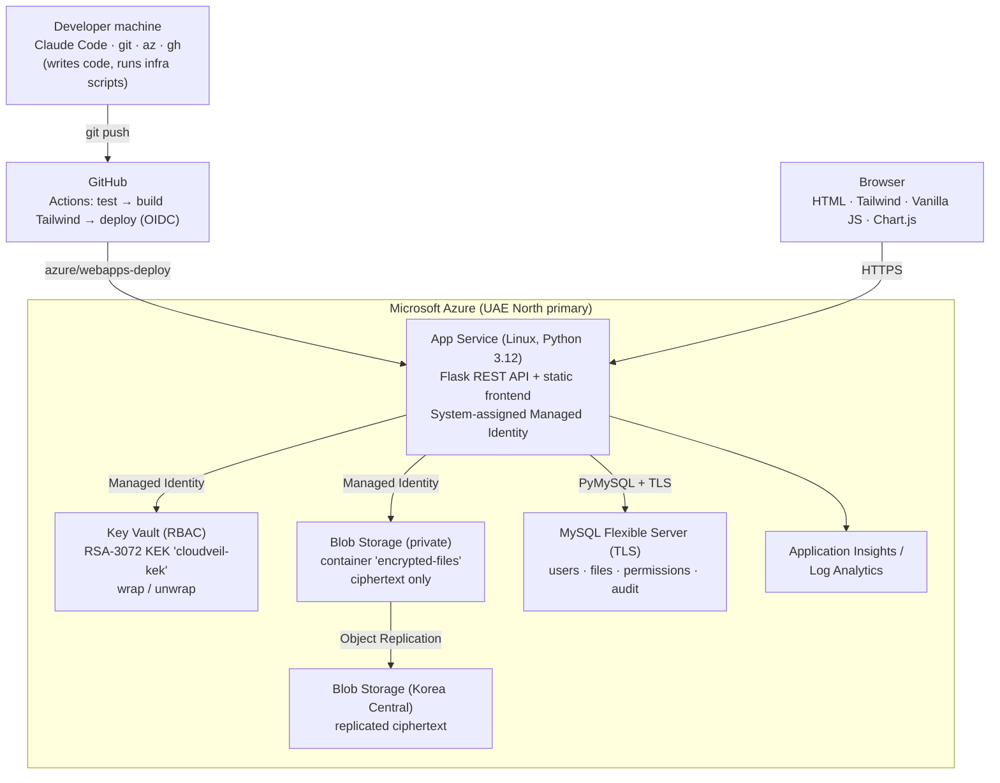
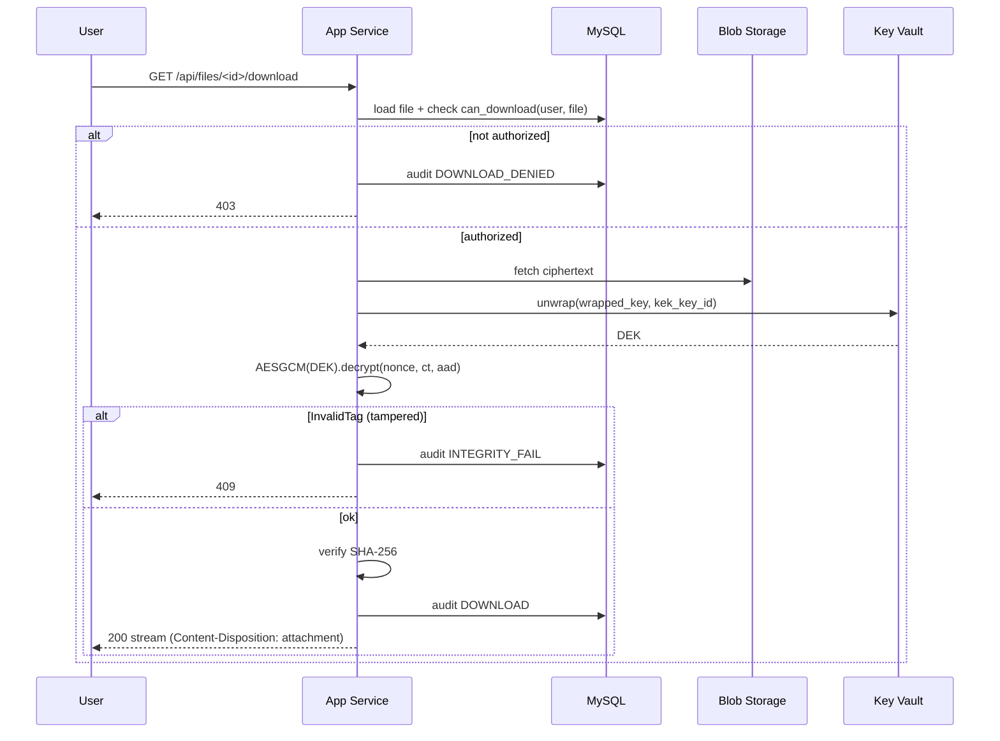

# CloudVeil — Architecture

## System overview



## Envelope-encryption flow (upload)

```mermaid
sequenceDiagram
    participant U as User (browser)
    participant A as App Service (Flask)
    participant KV as Key Vault
    participant B as Blob Storage
    participant DB as MySQL

    U->>A: POST /api/files (multipart, JWT cookie + CSRF)
    A->>A: validate (ext + magic bytes)
    A->>A: DEK = AES-256-GCM key; nonce = 12 random bytes
    A->>A: ciphertext = AESGCM(DEK).encrypt(nonce, file, aad)
    A->>KV: wrap(DEK) via RSA-OAEP-256
    KV-->>A: wrapped_key + kek_key_id
    A->>B: upload ciphertext to files/<uuid>.bin
    A->>DB: INSERT file row (wrapped_key, nonce, sha256, …)
    A->>DB: INSERT audit row (UPLOAD)
    A-->>U: 201 { file metadata }
    Note over A: plaintext DEK dropped; never stored
```

## Authorize-and-decrypt flow (download)



## Key design points

- **Managed Identity everywhere** for Azure services — no storage keys or Key
  Vault secrets in the app. Access is RBAC: the identity has *Key Vault Crypto
  User* and *Storage Blob Data Contributor* only.
- **The KEK never leaves Key Vault.** Only wrap/unwrap operations cross the
  boundary; the database stores just the wrapped key and the key id/version.
- **Per-file DEK + nonce**, with AAD binding ciphertext to `(file_id, owner_id)`
  so a blob cannot be replayed under a different file/owner.
- **Single authorization choke point** (`can_download`) that is exhaustively
  unit-tested; every denial is audited.
- **Append-only audit** of every security-relevant action.
- **CI/CD via OIDC** — no long-lived cloud credentials in GitHub.

See `security-design.md` for the threat model and `api.md` for the REST API.
